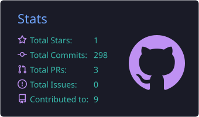
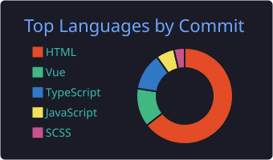

 

# Владимир Хлюпнев

**Senior Fullstack Developer · Technical Lead**

*Vue / Nuxt / React · TypeScript · Node.js · Архитектура web-продуктов*

 

---

## Ключевые результаты

| Направление | Результат | Проект / компания |
| --- | --- | --- |
| 🚀 Запуск продуктов | **4 публичных продукта за первые 4 месяца** | Алабуга ОЭЗ ППТ |
| 🛠 Поддержка | **15+ production-проектов** параллельно | Алабуга ОЭЗ ППТ |
| 👥 Масштаб ERP | **30 000+ пользователей** | АПХ ЭКО-культура |
| ⚡ Загрузка таблиц | **6 с → 0,8 с (×7,5)** · около 1 млн записей | АПХ ЭКО-культура |
| 📦 Frontend-ассеты | Сокращение размера **более чем на 80%** | Коммерческие проекты |
| 📈 Производительность | **Core Web Vitals 95–100** · Lighthouse Performance **90+ на мобильных** | Публичные проекты |
| 🏗 Enterprise-разработка | Участие в **25+ production-проектах** | Haulmont |

---

## О себе

Инженер с **более чем 6 годами опыта** разработки высоконагруженных web-приложений. Специализируюсь на архитектуре и запуске продуктов полного цикла на **Vue.js, Nuxt.js, TypeScript и Node.js**. Есть практический опыт с React, Next.js, Rust и Tauri.

Совмещаю роли **Technical Lead и ведущего разработчика**: принимаю архитектурные решения, руковожу кросс-функциональной командой, развиваю инженерные процессы, провожу code review и участвую в найме.

С апреля 2026 года — **Senior Fullstack Developer в Алабуга ОЭЗ ППТ**. Отвечаю за техническое развитие frontend-платформы внутренних и публичных продуктов. Ранее как **Founding Engineer** самостоятельно спроектировал и запустил zaborrf.ru — от выбора стека и разработки до инфраструктуры, SEO и дальнейшего развития.

---

## Tech Stack

### Frontend

### Backend & DevOps

### Архитектура и дополнительные технологии

**Архитектура:** FSD · Atomic Design · Design System · Module Federation · Code Splitting 
**API:** REST · GraphQL · gRPC · Express 
**Инфраструктура:** Docker Compose · Linux · Git · JMeter · Lighthouse

---

## 🛠 Главный Pet-проект: YTooly

**30+ онлайн-инструментов в едином интерфейсе** — конвертация медиа, онлайн-радио с 3D-визуализацией, маркетплейс с монетизацией, шейдер-редактор, финансовые и dev-инструменты.

> Полный цикл разработки: от FSD-архитектуры до платёжной системы.

| Область | Решение |
| --- | --- |
| Архитектура | Feature-Sliced Design (FSD) · Nuxt 3 SSR+SSG · TypeScript strict |
| Backend | Nitro + PostgreSQL 18 · REST API · WebSocket |
| Монетизация | Stripe (карты) + NowPayments (BTC/ETH/USDT) · HMAC-SHA256/SHA512 |
| 3D / WebGL | Three.js (аудиовизуализация) · GLSL шейдер-редактор с live-preview |
| UX | Drag-and-drop маркетплейс · тёмная тема · glassmorphism · PWA |
| Качество | Vitest · Playwright E2E · ESLint · Prettier · Husky |

---

## 📦 Open Source и творческие проекты

- **<a href="https://github.com/proksiks/image-pan-zoom" target="_blank" rel="noopener noreferrer">image-pan-zoom</a>** — библиотека панорамирования и масштабирования изображений
- **<a href="https://github.com/proksiks/swipe-handler" target="_blank" rel="noopener noreferrer">swipe-handler</a>** — обработка свайпов и жестов
- **<a href="https://steamcommunity.com/sharedfiles/filedetails/?id=3602769648" target="_blank" rel="noopener noreferrer">Audio Visualizer</a>** — WebGL-визуализатор для Wallpaper Engine

- **<a href="https://steamcommunity.com/sharedfiles/filedetails/?id=3786407293" target="_blank" rel="noopener noreferrer">Новый проект в Steam Workshop</a>**

---

## 📊 GitHub Stats

### GitHub Snake

<picture>
  <source media="(prefers-color-scheme: dark)" srcset="https://raw.githubusercontent.com/proksiks/proksiks/output/github-snake-dark.svg?v=2" />
  <source media="(prefers-color-scheme: light)" srcset="https://raw.githubusercontent.com/proksiks/proksiks/output/github-snake.svg?v=2" />
  
</picture>

---

## Опыт — кратко

| Период | Компания / роль | Основной вклад |
| --- | --- | --- |
| 04.2026 — н.в. | **Алабуга ОЭЗ ППТ** · Senior Fullstack Developer | 4 публичных продукта на Nuxt 4 за первые 4 месяца; поддержка 15+ production-проектов; собеседования и code review |
| 11.2025 — 03.2026 | **ИП Торопцев** · Founding Engineer | Запуск zaborrf.ru: архитектура, frontend, backend, инфраструктура, SEO и техническое развитие |
| 07.2025 — 10.2025 | **АПХ ЭКО-культура** · Разработчик ПО | ERP для 30 000+ пользователей; offline-first, разграничение доступа, ускорение таблиц более чем в 7 раз |
| 04.2024 — 04.2025 | **ИТЛ Консалтинг** · Fullstack-разработчик | Инженерные web-приложения, OpenLayers, Telegram Mini Apps, PWA, SVG→JSON, интеграция с Java и presale |
| 01.2021 — 04.2024 | **Haulmont** · Инженер-программист | 25+ production-проектов; миграция Vue 2 → Vue 3; оптимизация производительности; корпоративные порталы, SaaS и публичные сайты |
| 01.2020 — 09.2020 | **BIGART** · Web-программист | Первый коммерческий опыт разработки веб-проектов |

### Публичные продукты в Алабуге

- <a href="https://ais.alabuga.ru/" target="_blank" rel="noopener noreferrer">Международная школа ОЭЗ Алабуга</a>
- <a href="https://dxlc.ru/" target="_blank" rel="noopener noreferrer">Контейнерный терминал</a>
- <a href="https://career.dev-alb.ru/bme/" target="_blank" rel="noopener noreferrer">Большой математический эксперимент</a>
- <a href="https://med.alabuga.ru/" target="_blank" rel="noopener noreferrer">Медицинский центр ОЭЗ Алабуга</a>

**Образование:** Самарский государственный университет путей сообщения · бакалавр, менеджмент и логистика · 2020. 
**Языки:** русский — родной · английский — B1.

---

### Открыт к предложениям Senior Fullstack Developer / Team Lead

Самара · Удалённо / Гибрид · Готов к командировкам · Без переезда

